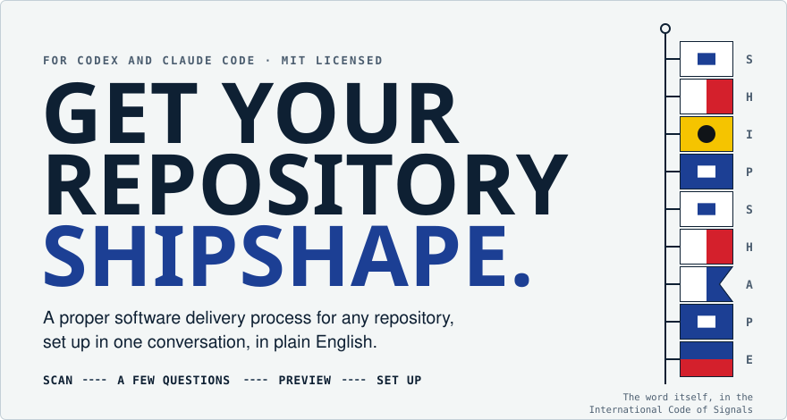
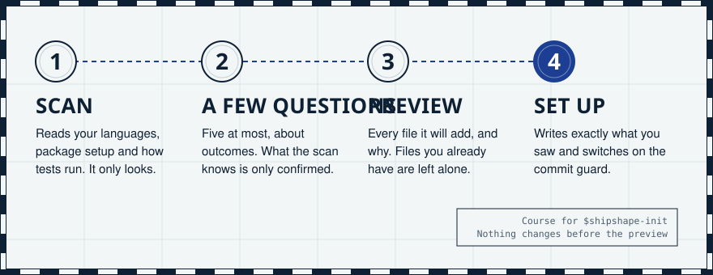

<div align="center">

<picture>
  <source media="(prefers-color-scheme: dark)" srcset="site/assets/readme/hero-dark.svg">
  
</picture>

[](https://github.com/KevNev19/shipshape/actions/workflows/ci.yml)
[](https://github.com/KevNev19/shipshape/actions/workflows/codeql.yml)
[](https://github.com/KevNev19/shipshape/releases)
[](LICENSE)

**[Website](https://kevnev19.github.io/shipshape/)** · **[Get it](#get-it)** · **[Commands](#the-commands)** · **[Releases](https://github.com/KevNev19/shipshape/releases)**

</div>

You have a project. Maybe you're a seasoned engineer, maybe you've never
heard the word "CI". Either way, your repository deserves automated tests,
secret protection, dependency monitoring, and releases that don't rely on
memory and luck.

**Shipshape** is a plugin for Codex and Claude Code that sets all of that up
for you, conversationally. It scans your repo, asks a handful of
plain-language questions, shows you exactly what it will create, and writes
it on your go-ahead. Everything it writes is standard, boring, reliable
tooling. Delete the plugin tomorrow and your setup keeps working.

## How it works

<picture>
  <source media="(prefers-color-scheme: dark)" srcset="site/assets/readme/course-dark.svg">
  
</picture>

<details>
<summary>Read the course as text</summary>

1. **Scan.** Reads your languages, package setup and how tests run. It only
   looks.
2. **A few questions.** Five at most, about outcomes. What the scan knows is
   only confirmed.
3. **Preview.** Every file it will add, and why. Files you already have are
   left alone.
4. **Set up.** Writes exactly what you saw and switches on the commit guard.

Nothing changes before the preview.

</details>

Run `$shipshape-init` in Codex, or `/shipshape-init` in Claude Code, in any
repository from an empty folder to a ten-year-old codebase. Nothing in your
project changes until you've seen the whole plan and said go. A GitHub rule
that protects `main` is a separate yes.

## How it feels

<picture>
  <source media="(prefers-color-scheme: dark)" srcset="site/assets/readme/conversation-dark.svg">
  
</picture>

<details>
<summary>Read the conversation as text</summary>

> **you:** `$shipshape-init`
>
> **shipshape:** This looks like a Python project that uses pytest for its
> tests. Is that right?
>
> **you:** yep. it's just me working on it
>
> **shipshape:** Got it: solo, changes go straight to main, and checks run
> after each push. Here's the plan, and nothing you already have gets
> touched:
>
> - `.github/workflows/ci.yml`: runs your tests on GitHub after each push to main
> - `.sdlc/hooks/secret-guard.sh`: stops a commit that adds a key or credential file
> - `docs/sdlc/harness.md`: your working agreement, in plain English
> - …
>
> Shall I go ahead?
>
> **you:** go ahead
>
> **shipshape:** Done. Everything is written, and the secret guard is on for
> this copy. Next step: commit these new files and push them to GitHub.

</details>

After your next push the checks start running on GitHub, a guard watches
every commit on your computer, and a `docs/sdlc/` folder explains the whole
setup.

## What's watching your back

<picture>
  <source media="(prefers-color-scheme: dark)" srcset="site/assets/readme/watch-bill-dark.svg">
  
</picture>

<details>
<summary>Read the watch bill as text</summary>

- **Every commit, on your computer · Secret guard.** Stops a commit that adds
  a key file (like `.env` or a private key) or a known AWS, GitHub, Slack,
  Stripe or Google token. Flags changes to files that steer AI tools.
- **Pushes and pull requests to main · CI.** Runs your tests on GitHub. In
  straight-to-main mode it reports after the change lands.
- **Pushes and pull requests to main · Secret scan.** Checks every new commit
  again on GitHub, so a key added in one commit and deleted in the next is
  still caught.
- **Pushes, pull requests and weekly · CodeQL.** For Python,
  JavaScript/TypeScript, Go, Java, Ruby or C# code: finds known security
  mistakes and lists them in the Security tab. Free on public repositories.
- **Weekly · Dependabot.** Suggests newer versions of your libraries and
  GitHub Actions as pull requests.
- **Every Wednesday · Health check.** Re-checks every protection and, when
  anything is rated WARN or FAIL, opens or updates one issue with the counts
  and the next thing to fix.
- **You push a version tag · Release.** Publishes a GitHub release for that
  exact commit, only if its checks passed on GitHub.
- **Once you say yes · Branch rule.** Stops anyone deleting main or
  overwriting its history with a force-push.

</details>

Security is the centre of the kit, not an add-on. Everything here that fits
your project comes switched on for a solo, straight-to-main setup, except the
branch rule, which waits for your yes. Switching off a security guard or the
health check means hearing the consequence in one plain sentence and saying
yes anyway.

## The commands

| Command | What it does |
|---|---|
| `$shipshape-init` | The front door. Scan, interview, preview, set up. You confirm each check command it finds before it's saved. |
| `$shipshape-doctor` | Read-only health check: problems first, then one next step. |
| `$shipshape-review` | Plain-words review of any change (code, spec, plan or docs) with a clear verdict, flagging weakened tests. Runs your project's own checks on local work, asking first on a branch someone else wrote; never merges or approves. |
| `$shipshape-release` | Checks your tests passed, suggests a version, publishes on your yes. |
| `$shipshape-access` | "Give Sam access" becomes the exact GitHub command, shown first. |
| `$shipshape-customize` | Change anything off the defaults; only affected files regenerate. |
| `$shipshape-intent` | Records what a bigger change is for and how you'll know it worked. |
| `$shipshape-orchestrate` | Coordinate a bounded change through the worker runtime for the current host. |

The examples use Codex's `$skill-name` syntax; in Claude Code, invoke the same
entrypoints as `/skill-name`. The six setup, customization, access, intent,
release, and review skills require explicit `$skill-name` invocation in Codex.
Claude Code exposes their descriptions to its model, so their shared skill
bodies independently require a matching user request before they act; all
existing preview, no-clobber, and confirmation gates still apply.

## Orchestration by host

| Host | Coordinator and worker route |
|---|---|
| Codex | The user's selected Codex model coordinates Claude workers through [coredo-eu/codex-claude-orchestrator](https://github.com/coredo-eu/codex-claude-orchestrator), pinned to [`519ccac`](https://github.com/coredo-eu/codex-claude-orchestrator/commit/519ccacda39aafe3ea703cc871d93b141eb8089b). |
| Claude Code | The user's selected Claude model coordinates Codex workers through [alexzh3/codex-orchestrator](https://github.com/alexzh3/codex-orchestrator). |

The coordinator remains whichever model the user selected in the host; Astra
is one example, not a requirement. Routing by host is core behavior. Choosing
individual worker models inside that route is secondary. Shipshape does not
install either orchestrator plugin.

## Why you can trust it with your repo

- **Nothing is ever clobbered.** Shipshape remembers the fingerprint of every
  file it writes. Edit one, and it becomes *yours*: future runs report it
  and ask, file by file, before touching it. A file you already had is
  replaced only if you say yes to that exact file.
- **Files explain themselves.** Generated files open with what they are, why
  you have them, and whether they're safe to edit. A glossary defines every
  term the tooling uses.
- **Plain words, honest verdicts.** Skills translate ("the login test
  expected X and got Y"), a red CI never gets called "looks safe", and a
  file being present is never reported as a check that ran.
  `python3 .sdlc/scripts/checks.py run .` runs your saved checks and
  reports each one, and a review flags deleted, skipped or weakened
  tests by file and line.
- **It runs on itself.** This repository was set up by shipshape: its secret
  guard, CodeQL, Dependabot, release workflow and weekly health check are
  its own output. Where a file was already hand-written, shipshape left it
  alone, as it will in yours. See [`docs/sdlc/`](docs/sdlc/).

## Make it yours

One file, `.sdlc/config.json`, drives everything: working style
(straight-to-main or pull-request), team or solo, features on or off, check
commands, reviewers. Change it with `$shipshape-customize`; shipshape
regenerates only what's affected and leaves your edits alone.

## Under the hood

For the curious: a stdlib-only Python engine (`detect.py` → `render.py` →
`protection.py` → `doctor.py`), token-substitution templates with zero
template logic, frozen-fixture tests, and dated regression checks that keep
fixed bugs from coming back. Decisions are recorded in
[`docs/adr/`](docs/adr/). Run the whole pipeline against a scratch repo with
`bash tests/e2e.sh`.

The [website](https://kevnev19.github.io/shipshape/) lives in
[`site/`](site/) and deploys to GitHub Pages from `main`. The art in this
README is generated from the site's own fonts and colours by
[`site/tools/build_readme_art.py`](site/tools/build_readme_art.py).

## Get it

<picture>
  <source media="(prefers-color-scheme: dark)" srcset="site/assets/readme/install-dark.svg">
  
</picture>

Register the published Shipshape marketplace and install it in Codex:

```bash
codex plugin marketplace add KevNev19/shipshape
codex plugin add shipshape@shipshape
```

Then start a new Codex conversation in the repository you want to set up and
run `$shipshape-init`. The bundled `.codex-plugin/plugin.json` describes the
plugin; adding that manifest to a checkout does not install it by itself. Git
marketplace commands fetch the version published on GitHub, not uncommitted
changes in a local checkout.

To use an unpublished local checkout with Codex, register its actual absolute
path instead (after resolving any existing marketplace with the same name):

```bash
codex plugin marketplace add "/absolute/path/to/shipshape"
codex plugin add shipshape@shipshape
```

The local Codex CLI accepts a local marketplace path. Its currently configured
published Shipshape entry is discovered from the existing
`.claude-plugin/marketplace.json`; this checkout additionally supplies the
native `.codex-plugin/plugin.json`. Start a new conversation after installing
so the skills are loaded from that checkout.

In Claude Code, use its in-app marketplace commands:

```text
/plugin marketplace add KevNev19/shipshape
/plugin install shipshape@shipshape
/shipshape-init
```

Replace `KevNev19/shipshape` with the checkout's absolute path to test local,
unpublished Claude Code changes.

Needs `git` and Python 3.10 or newer (check with `python3 --version`). On
macOS, `xcode-select --install` provides git; get a current Python from
python.org or Homebrew. On Linux, use your package manager. Releases, access
changes and the GitHub branch rule also need the GitHub CLI (`gh`), signed
in; shipshape tells you how to install it if it's missing.

<br>

<picture>
  <source media="(prefers-color-scheme: dark)" srcset="site/assets/readme/footer-dark.svg">
  
</picture>

MIT © [KevNev19](https://github.com/KevNev19) · Set in Big Shoulders Stencil
and Atkinson Hyperlegible, under the [SIL Open Font License](site/assets/fonts/).
